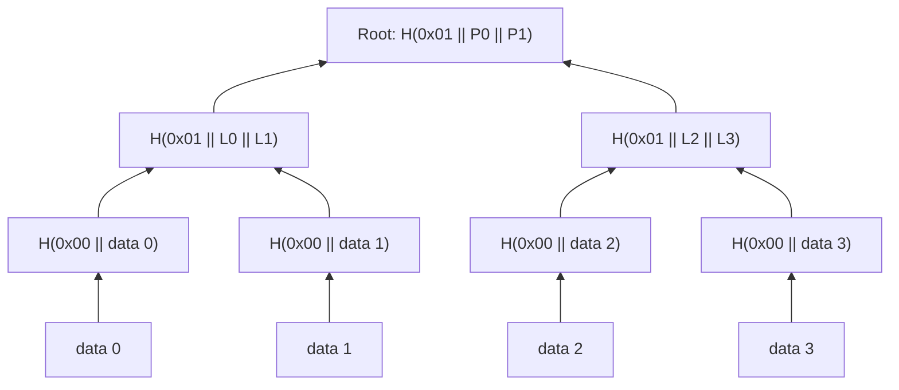

---
tags:
  - Merkle
owner: docs
last_reviewed: 2026-09-22
source_repos:
  - repo: ergoplatform/ergo
    branch: master
    paths:
      - ergo-core/src/main/scala/org/ergoplatform/modifiers/history/BlockTransactions.scala
  - repo: ergoplatform/scrypto
    branch: master
    paths:
      - shared/src/main/scala/scorex/crypto/authds/merkle/BatchMerkleProof.scala
      - shared/src/main/scala/scorex/crypto/authds/merkle/MerkleTree.scala
      - shared/src/main/scala/scorex/crypto/authds/merkle/Node.scala
      - shared/src/main/scala/scorex/crypto/authds/merkle/MerkleProof.scala
      - shared/src/main/scala/scorex/crypto/authds/merkle/serialization/BatchMerkleProofSerializer.scala
source_of_truth:
  - https://github.com/ergoplatform/scrypto/commit/987e7c7fd5531dcab9241be91d4f6e3ca717b56d
  - https://github.com/ergoplatform/scrypto/commit/08ef4efc86add19f2d07ec8454ed42393b8d5183
  - https://github.com/ergoplatform/ergo/tree/master/ergo-core/src/main/scala/org/ergoplatform/modifiers/history/BlockTransactions.scala
  - https://github.com/ergoplatform/scrypto/tree/master/shared/src/main/scala/scorex/crypto/authds/merkle/BatchMerkleProof.scala
  - https://github.com/ergoplatform/scrypto/tree/master/shared/src/main/scala/scorex/crypto/authds/merkle/MerkleTree.scala
---

# Merkle Tree Format in Ergo

Merkle Trees are a fundamental data structure in the Ergo blockchain, used to ensure the integrity and authenticity of data. This page explains the specific structure, encoding scheme, and cryptographic methods used in the Merkle Tree format within Ergo, providing essential information for developers working with Merkle proofs and validating transaction inclusion.

## Overview

A Merkle Tree is a binary tree where each node contains a cryptographic hash. Leaf nodes represent the hash of individual data elements, such as transactions, while non-leaf nodes represent the hash of their child nodes. The topmost node, known as the Merkle Root, serves as a cryptographic commitment to the entire dataset. This structure allows for efficient verification of data integrity, allowing membership of a supplied leaf to be checked against a trusted root without downloading every leaf. It does not validate the rest of the dataset.

The diagram uses `H` for Blake2b-256 and `||` for byte concatenation.

## Leaf Nodes

For transaction roots, leaf content depends on the block version:

- In the initial block version, leaves are transaction IDs.
- In later block versions, leaves are transaction IDs followed by witness IDs. A witness ID is the digest of the transaction's serialized spending proofs.

The leaf node hash is `Blake2b256(0x00 || data)`. The `0x00` prefix provides domain separation; the leaf position is not part of the hash. Equal data therefore produces equal leaf hashes. Current `scrypto` trees retain every leaf position, and hash-based proof lookup chooses the first equal hash; use index-based lookup when duplicate leaves must be distinguished.

- **Code Reference**: The implementation of leaf node hashing can be found in [Node.scala](https://github.com/ergoplatform/scrypto/blob/85863595fa2d59cffc207b94d6d7393d3011da6c/shared/src/main/scala/scorex/crypto/authds/merkle/Node.scala#L37-L39) file in the `scrypto` repository.

## Internal Nodes

Internal nodes are constructed by hashing the concatenation of their two child nodes. The hash function used is the `Blake2b256` cryptographic hash function. Internal nodes do not include keys in their hash inputs, optimizing proof sizes by focusing only on the hashes of child nodes.

To construct an internal node, the following steps are taken:

1. **Concatenate**: Combine the **1-byte prefix** for internal nodes (`0x01`) with the hashes of the left and right child nodes.
2. **Hash**: Apply the `Blake2b256` function to the concatenated result to produce the hash for the internal node.

**Code Reference**:  The code for internal node hashing is in [Node.scala](https://github.com/ergoplatform/scrypto/blob/85863595fa2d59cffc207b94d6d7393d3011da6c/shared/src/main/scala/scorex/crypto/authds/merkle/Node.scala#L19-L22) file in the `scrypto` repository.

## Merkle Root

The Merkle Root is the final hash at the top of the Merkle Tree. It is computed by recursively hashing the tree from the leaf nodes up to the root. The Merkle Root serves as a cryptographic commitment to all the transactions included in the block, ensuring that any tampering with the data can be detected.

In Ergo, the Merkle Root is included in the block header, committing to the transaction leaf sequence. A matching membership proof does not replace header-chain or transaction validation.

- **Code Reference**: The Merkle Root calculation and its inclusion in the block header are managed in the [BlockTransactions.scala](https://github.com/ergoplatform/ergo/blob/master/ergo-core/src/main/scala/org/ergoplatform/modifiers/history/BlockTransactions.scala) file in the Ergo repository.

## Merkle Proof Encoding

A single `MerkleProof` contains the original leaf data and sibling/side pairs, ordered from the leaf toward the root. In this structure:

1. **Side marker**: `0x00` places the computed hash on the left of its sibling; `0x01` places it on the right.
2. **Sibling digest**: A normal Blake2b-256 digest is 32 bytes. Scrypto represents an empty sibling internally with a zero-length byte array.

The verifier starts with `Blake2b256(0x00 || data)`. At each level it computes `Blake2b256(0x01 || leftHash || rightHash)`, using the side marker to choose the order. The final digest must match the expected root from an authenticated source.

These are the fields used by [MerkleProof.scala](https://github.com/ergoplatform/scrypto/blob/85863595fa2d59cffc207b94d6d7393d3011da6c/shared/src/main/scala/scorex/crypto/authds/merkle/MerkleProof.scala#L21-L48), not a universal single-proof byte encoding.

For **batch proofs**, [`BatchMerkleProofSerializer`](https://github.com/ergoplatform/scrypto/blob/85863595fa2d59cffc207b94d6d7393d3011da6c/shared/src/main/scala/scorex/crypto/authds/merkle/serialization/BatchMerkleProofSerializer.scala) writes two four-byte counts, followed by indexed leaves (`four-byte index || digest`) and proof entries (`digest || one-byte side`). With Blake2b-256 these entries are 36 and 33 bytes respectively; an all-zero proof digest encodes an empty sibling. The batch marker describes the **stored sibling's** side, opposite to the single-proof marker above: `0x00` is a left sibling and `0x01` a right sibling.

The batch deserializer requires the input to end exactly at the proof boundary and rejects negative counts or indices, invalid side markers, malformed lengths, and trailing bytes.

- **Code Reference**: Batch verification is implemented in [BatchMerkleProof.scala](https://github.com/ergoplatform/scrypto/blob/85863595fa2d59cffc207b94d6d7393d3011da6c/shared/src/main/scala/scorex/crypto/authds/merkle/BatchMerkleProof.scala).

## Validation

For details on the validation process for Merkle proofs, including examples and step-by-step instructions, please refer to the [Merkle Validation](merkle-validation.md) page.
