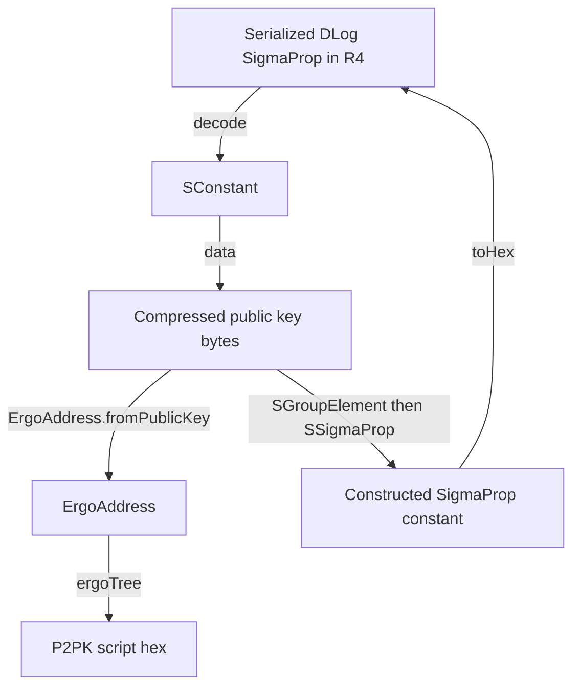

---
tags:
  - fleet-sdk
  - typescript
  - javascript
  - sigmaprop
  - ergotree
  - registers
  - p2pk
  - validation
  - tutorial
  - serialization
  - deserialization
  - token-id
  - numeric-registers
  - compiler
  - troubleshooting
owner: docs
last_reviewed: 2026-10-26
source_repos:
  - repo: fleet-sdk/fleet
    branch: master
    paths:
      - packages/serializer/src/sigmaConstant.ts
      - packages/serializer/src/types/descriptors.ts
      - packages/compiler/src/compiler.ts
source_of_truth:
  - https://github.com/fleet-sdk/fleet/blob/master/packages/serializer/src/sigmaConstant.ts
  - https://github.com/fleet-sdk/fleet/blob/master/packages/serializer/src/types/descriptors.ts
  - https://github.com/fleet-sdk/fleet/blob/master/packages/compiler/src/compiler.ts
---

# Fleet SDK Recipes

These helpers were checked with `@fleet-sdk/core` **0.12.0**, `@fleet-sdk/serializer` **0.11.0**, and `@fleet-sdk/compiler` **0.12.0**. Copy the shared setup and the functions you need into an existing TypeScript project. The register fixtures below are fabricated test data, not funded wallet examples.

## Table of Contents

- [Validating Box Ownership](#validating-box-ownership-sigmaprop-from-register)
- [Working with Numeric Registers](#working-with-numeric-registers)
- [Extracting Token IDs](#extracting-token-ids-from-registers)
- [Tuples, Options, and Collections](#decoding-complex-types-tuples-options-collections)
- [Compiling ErgoScript](#compiling-ergoscript-to-ergotree)
- [Troubleshooting](#troubleshooting-common-issues)
- [Relationship Diagram](#relationship-diagram)
- [Related Documentation](#related-documentation)

Fleet's `decode()` returns an `SConstant` with an `SType` object in `.type` and a decoded payload in `.data`; it returns `undefined` on decoding failure. `SConstant.from()` throws on failure. Neither API returns the invented `{ type: "SLong", value: ... }` structure. Tuple and collection payloads contain decoded values, not another wrapper around every element.

Use this shared setup for the functions below:

```typescript
import { ErgoAddress } from "@fleet-sdk/core";
import {
  isColl, isTuple, SByteType, SConstant, SGroupElementType,
  SIntType, SLongType, SSigmaPropType, SigmaByteReader
} from "@fleet-sdk/serializer";

type RegisterId = "R4" | "R5" | "R6" | "R7" | "R8" | "R9";
type RegisterBox = { additionalRegisters: Partial<Record<RegisterId, string>> };

function readConstant(hex?: string) {
  if (!hex) return undefined;
  try {
    const reader = new SigmaByteReader(hex);
    const constant = SConstant.from(reader);
    // Reject a valid constant followed by unconsumed trailing bytes.
    return reader.isEmpty ? constant : undefined;
  } catch {
    return undefined;
  }
}

function toHex(bytes: Uint8Array): string {
  return Array.from(bytes, (byte) => byte.toString(16).padStart(2, "0")).join("");
}
```

## Validating Box Ownership (SigmaProp from Register)

This comparison checks whether a box's P2PK script matches the public key encoded in another box's R4. It does not prove that the caller controls the key or satisfy other spending conditions. The helper accepts a DLog `SigmaProp`, a `GroupElement`, or a `Coll[Byte]` containing a compressed public key. Arbitrary Sigma propositions are not interchangeable with public keys.

### Complete Example

The following function uses the shared setup above. In the checked serializer, a decoded DLog SigmaProp's `.data` is the public-key `Uint8Array` directly.

```typescript
function validateBoxOwnership(
  boxToValidate: { ergoTree: string },
  boxWithOwnerInfo: RegisterBox
): boolean {
  const constant = readConstant(boxWithOwnerInfo.additionalRegisters.R4);
  if (!constant) return false;
  const type = constant.type;
  const isKeyType = type instanceof SSigmaPropType ||
    type instanceof SGroupElementType ||
    (isColl(type) && type.elementsType instanceof SByteType);
  const key = constant.data;
  if (!isKeyType || !(key instanceof Uint8Array) || key.length !== 33) return false;
  if (key[0] !== 2 && key[0] !== 3) return false;
  try {
    return boxToValidate.ergoTree.toLowerCase() === ErgoAddress.fromPublicKey(key).ergoTree;
  } catch {
    return false;
  }
}
```

## Working with Numeric Registers

`SInt` decodes to a JavaScript `number`; `SLong` decodes to `bigint`. Keep long values as integers throughout calculations. A deadline may be a height or a timestamp: use the unit defined by the contract. The compiler example below uses a block height, so compare it with `HEIGHT`, not `Date.now()`.

```typescript
function getNumericFromRegister(box: RegisterBox, register: RegisterId): bigint | null {
  const constant = readConstant(box.additionalRegisters[register]);
  if (!constant || !(constant.type instanceof SIntType || constant.type instanceof SLongType)) {
    return null;
  }
  const data = constant.data;
  return typeof data === "bigint" || typeof data === "number" ? BigInt(data) : null;
}
```

## Extracting Token IDs from Registers

A token ID stored as `Coll[Byte]` decodes to `Uint8Array`. Check both its type and its 32-byte length; another byte collection is not automatically a token ID.

```typescript
function getTokenIdFromRegister(box: RegisterBox, register: RegisterId): string | null {
  const constant = readConstant(box.additionalRegisters[register]);
  if (!constant || !isColl(constant.type) || !(constant.type.elementsType instanceof SByteType)) {
    return null;
  }
  const bytes = constant.data;
  return bytes instanceof Uint8Array && bytes.length === 32 ? toHex(bytes) : null;
}
```

## Decoding Complex Types (Tuples, Options, Collections)

Check the outer type and its element descriptors before interpreting `.data`. For tuples, `.type.elementsType` is an array of element types. For collections, it is the collection's element type.

**Example 1: Decoding a Tuple `(SigmaProp, Long)` from R5**

This helper accepts the DLog SigmaProp form only. The tuple payload is `[Uint8Array, bigint]` in the checked version.

```typescript
function decodeSigmaPropLongTuple(
  box: RegisterBox, register: RegisterId
): { ownerPubKeyHex: string; deadline: bigint } | null {
  const constant = readConstant(box.additionalRegisters[register]);
  if (!constant || !isTuple(constant.type)) return null;
  const types = constant.type.elementsType;
  if (types.length !== 2 || !(types[0] instanceof SSigmaPropType) || !(types[1] instanceof SLongType)) {
    return null;
  }
  const data = constant.data;
  if (!Array.isArray(data) || data.length !== 2) return null;
  const [key, deadline] = data;
  if (!(key instanceof Uint8Array) || key.length !== 33 || typeof deadline !== "bigint") return null;
  return { ownerPubKeyHex: toHex(key), deadline };
}
```

**Example 2: Options**

Serializer 0.11.0 does not expose a public `SOption` constructor. Do not invent an option decoder or assume that every on-chain optional value becomes `{ type: "SOption", value: ... }`. Check the contract's actual register representation and the serializer's supported types before building an integration.

**Example 3: Decoding a `Coll[Int]` from R7**

```typescript
function decodeCollInt(box: RegisterBox, register: RegisterId): number[] | null {
  const constant = readConstant(box.additionalRegisters[register]);
  if (!constant || !isColl(constant.type) || !(constant.type.elementsType instanceof SIntType)) {
    return null;
  }
  const data = constant.data;
  return Array.isArray(data) && data.every((item) => Number.isInteger(item)) ? data : null;
}
```

**Round-trip fixtures**

Run this after the setup and register helpers. These test constants have observable expected results. `SPair` constructs a two-element tuple; there is no public `STuple` constructor in the checked package.

```typescript
import { SByte, SColl, SGroupElement, SInt, SLong, SPair, SSigmaProp } from "@fleet-sdk/serializer";

// Public secp256k1 test point. No wallet secret is used.
const testPublicKey = "0279be667ef9dcbbac55a06295ce870b07029bfcdb2dce28d959f2815b16f81798";
const fixture: RegisterBox = { additionalRegisters: {
  R4: SSigmaProp(SGroupElement(testPublicKey)).toHex(),
  R5: SPair(SSigmaProp(SGroupElement(testPublicKey)), SLong(100n)).toHex(),
  R6: SColl(SByte, new Uint8Array(32).fill(1)).toHex(),
  R7: SColl(SInt, [1, 2, 3]).toHex(),
  R8: SInt(42).toHex(),
  R9: SLong(9007199254740993n).toHex()
} };

console.log(validateBoxOwnership({ ergoTree: ErgoAddress.fromPublicKey(testPublicKey).ergoTree }, fixture)); // true
console.log(getNumericFromRegister(fixture, "R8")); // 42n
console.log(getNumericFromRegister(fixture, "R9")); // 9007199254740993n, without Number rounding
console.log(getTokenIdFromRegister(fixture, "R6")); // "01" repeated 32 times
console.log(decodeSigmaPropLongTuple(fixture, "R5")?.deadline); // 100n
console.log(decodeCollInt(fixture, "R7")); // [1, 2, 3]
console.log(getNumericFromRegister(fixture, "R6")); // null: wrong type
```

## Compiling ErgoScript to ErgoTree

`compile()` from `@fleet-sdk/compiler` is synchronous and returns an `ErgoTree`. Serialize it explicitly when a transaction builder needs hex. Compilation can throw; it does not return a `{ ergoTree }` response object.

```typescript
import { compile } from "@fleet-sdk/compiler";

function compileToErgoTree(script: string): string {
  return compile(script).toHex();
}

const timedContractScript = `{
  val deadline = SELF.R4[Int].get
  sigmaProp(HEIGHT >= deadline)
}`;
const compiledTree = compileToErgoTree(timedContractScript);
console.log(typeof compiledTree); // "string"
```

A box using this contract must have an `Int` block-height deadline in R4. Missing or differently typed R4 values make `.get` fail. Compiling an ErgoTree does not create or fund a box, sign a transaction, or submit one.

## Troubleshooting Common Issues

### 1. ErgoTree Comparison Failures

Compare the exact script bytes and the contract's expected type. A serialized register constant, a public key, a P2PK ErgoTree, and a Base58 address are different representations. The standard P2PK ErgoTree begins with `0008cd`, while a serialized DLog SigmaProp constant begins with `08cd`; passing either entire value to `fromPublicKey()` is wrong.

```typescript
function troubleshootErgoTreeComparison(first: string, second: string): string {
  if (first.toLowerCase() === second.toLowerCase()) return "Exact Match";
  return first.startsWith("0008cd") && second.startsWith("0008cd")
    ? "Different P2PK scripts; compare the public keys."
    : "Different scripts; check the contract and serialized representation.";
}
```

### 2. Unexpected Register Format

Use the serializer instead of guessing types from one-byte prefixes or assuming a fixed one-byte collection length. Successful decoding does not establish a token's identity or a contract's meaning.

```typescript
function detectRegisterFormat(registerHex: string): string {
  return readConstant(registerHex)?.type.toString() ?? "Invalid or unsupported constant";
}

console.log(detectRegisterFormat(SInt(42).toHex())); // "SInt"
console.log(detectRegisterFormat("not hex")); // "Invalid or unsupported constant"
```

## Relationship Diagram



The diagram covers DLog/P2PK conversions. More complex Sigma propositions require their own interpretation.

## Related Documentation

- [Fleet SDK](fleet.md)
- [ErgoScript Sigma Propositions](sigma.md)
- [Box Registers Specification](boxes-and-registers.md)
- [ErgoTree Specification](ergotree.md)
- [Fleet SDK GitHub Examples](https://github.com/fleet-sdk/fleet-by-example)
- [Fleet SDK Compiler](https://github.com/fleet-sdk/fleet/tree/master/packages/compiler)
- [Fleet SDK Serializer](https://github.com/fleet-sdk/fleet/tree/master/packages/serializer)
